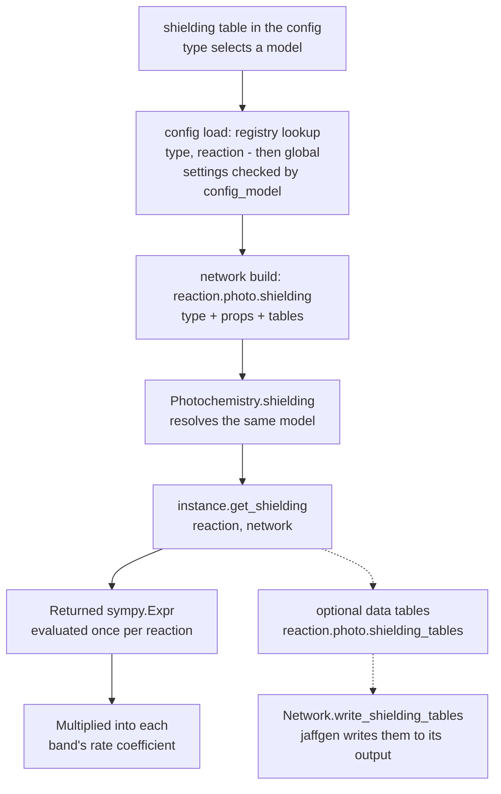

---
tags:
    - Development
icon: phosphor/sun
---

# Adding a Custom Shielding Function

A photo-reaction can attenuate its rate by a dimensionless **shielding factor**
`S`. JAFF resolves that factor from a **registry** of shielding models: each
model is a [`ShieldingFunction`](#the-shieldingfunction-contract) subclass that
registers itself with the `@_register` decorator, declares its settings as a
config model, and returns a [SymPy](https://www.sympy.org) expression that is
multiplied into the photo-rate. Adding a new model means writing one such class
in a subpackage of `physics/photo_reactions/shielding/` and importing it from that
subpackage's `__init__.py`.

There are two flavours, distinguished by the class's `reaction` attribute:

| Flavour    | Scope                        | `reaction` attr         | Location                                   |
| ---------- | ---------------------------- | ----------------------- | ------------------------------------------ |
| **Local**  | A single reaction            | the serialized reaction | `shielding/<sanitized_reaction>/<type>.py` |
| **Global** | Any reaction that selects it | `None`                  | `shielding/global_/<type>.py`              |

In both cases the class's `name` attribute is the keyword a reaction selects
with the `shielding` table's `type` (matched case-insensitively).

## How Shielding Is Resolved

A user selects a model with a `shielding` table, for one reaction or for every
photo reaction (see the [configuration reference](../user-guide/configuration/reference.md#networkreactionsphotoshielding)):

```toml
[network.reactions.reaction."H2._PHOTON__H.H".photo]
shielding = { type = "hg2015", min_ncol = 1.0e-35 }
```

1. **When the config loads**, the table's `type` is looked up in the registry —
   `(type, reaction)` first, then the global `(type, None)` — and the other
   keys are validated against the model's [`config_model()`](#the-shieldingfunction-contract).
   An unknown type, a model bound to another reaction or a bad setting is a
   config error naming the key path. A global `[network.reactions.photo]`
   shielding table may only use global models.
2. **When the network is built**, the photo reaction's resolved settings
   (`reaction.config`) hold the table as `reaction.config.photo.shielding`, a
   `ShieldingConfig` with `.type` and the settings in `.params`; the reaction
   starts with an empty `reaction.photo.shielding_tables`.
3. **When its rate is computed**, `Photochemistry.shielding`
   (`physics/photo_reactions/_photochemistry.py`) resolves the model the same
   way and calls its `get_shielding` **once per reaction**; the returned
   expression multiplies the rate coefficient of every radiation band.



The registry is filled on the first lookup by importing every **subpackage**
(folder) directly under `shielding/` whose name does not start with `_`
(`import_subpackages`). Only the folder's `__init__.py` is imported, so a model
registers — its `@_register` decorator runs — only if that `__init__.py` imports
its module (`from .hg2015 import HG2015`). There is no central list to edit, but a
module file that nothing imports is never registered, and a new folder needs an
`__init__.py` that imports its models.

## The `ShieldingFunction` Contract

Every shielding model — local or global — subclasses `ShieldingFunction`
(`shielding/_base.py`), sets two class attributes, declares its settings and
implements one method:

```python
from typing import cast

from sympy import Expr

from jaff.physics.photo_reactions.shielding import _register
from jaff.physics.photo_reactions.shielding._base import ShieldingFunction
from jaff.physics.photo_reactions.shielding.config import ShieldingParams


class MyModelParams(ShieldingParams):
    """Settings of my shielding model.

    Attributes
    ----------
    floor : float
        Lower floor on the column density (cm^-2).
    """

    floor: float = 1.0e-50


@_register
class MyModel(ShieldingFunction):
    name = "my_model"          # the shielding type keyword (lower-case)
    reaction = None            # None = global; a serialized reaction = local

    @staticmethod
    def config_model() -> type[MyModelParams]:
        return MyModelParams

    def get_shielding(self, reaction, network) -> Expr:
        params = cast(MyModelParams, self.params(reaction))
        ...
        return shielding_expr
```

| Member           | Purpose                                                                                                   |
| ---------------- | --------------------------------------------------------------------------------------------------------- |
| `name`           | Shielding type keyword, matched case-insensitively against the table's `type`.                            |
| `reaction`       | Serialized reaction this model is bound to (local), or `None` for a global model.                         |
| `config_model()` | Static method returning the model of its settings, a `ShieldingParams` subclass. Default: no settings.    |
| `params(reaction)` | Validates `reaction.config.photo.shielding.params` against `config_model()` and returns the typed settings. |
| `get_shielding`  | Returns the dimensionless `sympy.Expr`; may store data tables in `reaction.photo.shielding_tables`.      |

**Settings.** The `ShieldingParams` subclass is a regular
[config model](adding-configuration.md): it rejects unknown keys, is strict about
types, and its numpydoc `Attributes` become the key descriptions in the
[configuration reference](../user-guide/configuration/reference.md) and in
editors. Give each model its **own** params class, even when two models take the
same keys, so they can evolve independently. There is no hand-written input
checking left in `get_shielding`: read the settings through `self.params(reaction)`.

**Symbols.** The returned `Expr` may reference free symbols the code generator
resolves at runtime, by convention:

| Symbol           | Meaning                                              |
| ---------------- | ---------------------------------------------------- |
| `ncol_<species>` | Column density of `<species>` (cm⁻²), e.g. `ncol_H2` |
| `vdisp`          | Velocity dispersion (cm s⁻¹)                         |

**Data tables.** A model whose expression interpolates over tabulated data (like
Leiden's) puts the table on the reaction instead of writing a file:

```python
tables = reaction.photo.shielding_tables
tables[f"shielding_{reaction.serialized}.hdf5"] = h5dict
```

`Network.write_shielding_tables(directory)` writes every reaction's tables;
`jaffgen` calls it for its output directory. A plain Python `Network` builds
without writing anything.

## Writing a Local Shielding Function

A local model is bound to one reaction via its `reaction` attribute, set to that
reaction's **serialized** form. Serialisation joins the species on each side
with `.` and separates the two sides with `__`, and photo-reactions carry the
`_PHOTON` agent. For example, `H2 + _PHOTON -> H + H` serialises to
`H2._PHOTON__H.H`.

Because a serialized key contains characters that are illegal in a Python
package name (`.`, `+`, `-`), local models live in a folder whose name is the
**sanitised** serialized key — `.` → `_`, `+` → `j`, `-` → `k`. So
`H2._PHOTON__H.H` lives under `H2__PHOTON__H_H/`. The folder name is only a
filesystem container; the binding comes from the `reaction` class attribute,
which holds the real (unsanitised) serialized string.

```text
physics/photo_reactions/shielding/
└── H2__PHOTON__H_H/         # sanitized folder for H2._PHOTON__H.H
    ├── __init__.py          # from .db1996 import DB1996; from .hg2015 import HG2015
    ├── hg2015.py            # name = "hg2015"
    ├── db1996.py            # name = "db1996"
    └── _utils/              # shared helpers (leading "_" → not imported as a model)
        ├── __init__.py
        └── db_shielding_function.py
```

Following `H2__PHOTON__H_H/hg2015.py`:

```python
"""
H2 shielding by Hartwig et.al. 2015
DOI:https://doi.org/10.1093/mnras/stv1368
"""

from typing import cast

from sympy import Expr

from jaff.physics.photo_reactions.shielding import _register
from jaff.physics.photo_reactions.shielding._base import ShieldingFunction
from jaff.physics.photo_reactions.shielding.config import ShieldingParams

from ._utils import shielding


class HG2015Params(ShieldingParams):
    """Settings of the Hartwig et al. (2015) H2 self-shielding.

    Attributes
    ----------
    min_ncol : float
        Lower floor on the H2 column density (cm^-2).
    min_vdisp : float
        Lower floor on the velocity dispersion (cm/s).
    """

    min_ncol: float = 1.0e-50
    min_vdisp: float = 1.0e-50


@_register
class HG2015(ShieldingFunction):
    """Hartwig et al. (2015) H2 self-shielding (``shielding.type = "hg2015"``)."""

    name = "hg2015"
    reaction = "H2._PHOTON__H.H"

    @staticmethod
    def config_model() -> type[HG2015Params]:
        return HG2015Params

    def get_shielding(self, reaction, network) -> Expr:
        params = cast(HG2015Params, self.params(reaction))

        return shielding(
            alpha=1.1,
            min_ncol=params.min_ncol,
            min_vdisp=params.min_vdisp,
        )
```

<!-- prettier-ignore -->
!!! tip "Share maths between models"
    When several models in a folder differ only by a parameter (here `db1996.py`
    and `hg2015.py` differ only in `alpha`), put the expression builder in an
    helper package such as `_utils/`. A model folder's `__init__.py` imports only
    the model modules, so shared code there is never registered as a model.
    Keep the params classes separate.

## Writing a Global Shielding Function

A global model sets `reaction = None` and lives in `shielding/global_/`. It is
available to **any** reaction whose `type` matches its `name`, including in the
global `[network.reactions.photo]` table; it derives everything it needs from
the reaction passed to `get_shielding`.

```text
physics/photo_reactions/shielding/
├── global_/
│   ├── __init__.py         # from .leiden import Leiden
│   └── leiden.py           # name = "leiden", reaction = None
└── H2__PHOTON__H_H/
    └── ...
```

```toml
[network.reactions.reaction."CO._PHOTON__C.O".photo]
shielding = { type = "leiden", radiation = "isrf", shielded_by = ["self", "H2"] }
```

See `shielding/global_/leiden.py` for a full example: its `LeidenParams`
restricts `shielded_by` to the species the Leiden tables hold, and
`get_shielding` builds one interpolation call per shielding species and keeps
the per-reaction table in `reaction.photo.shielding_tables`.

## Checklist

- [x] Class subclasses `ShieldingFunction` and is decorated with `@_register`
- [x] `name` (lower-case) equals the `shielding` table's `type` keyword
- [x] `reaction` set to the serialized reaction (local) or left `None` (global)
- [x] Local model placed under the **sanitised** folder
      (`shielding/<sanitized_reaction>/<type>.py`); global under `shielding/global_/`
- [x] The folder's `__init__.py` imports the new class (a new folder needs one), and
      the folder name does not start with `_`
- [x] Its own `ShieldingParams` subclass with numpydoc `Attributes`, returned by
      `config_model()`
- [x] `get_shielding(self, reaction, network) -> sympy.Expr` reads its settings
      through `self.params(reaction)`
- [x] Returns a dimensionless expression using the `ncol_<species>` / `vdisp`
      symbol conventions; data tables go in `reaction.photo.shielding_tables`
- [x] Shared maths factored into an underscore-prefixed helper (if reused)
- [x] Schemas and reference regenerated
      (`uv run --extra dev python -m jaff.config.json_schema`,
      `uv run --extra dev python -m jaff.config.reference`) so editors and docs know
      the new type

## See Also

- [Adding configuration](adding-configuration.md)
- [Contributing Guide](contributing.md)
- [Code Style Guide](code-style.md)
- [Adding a New Network Parser](adding-parsers.md)
