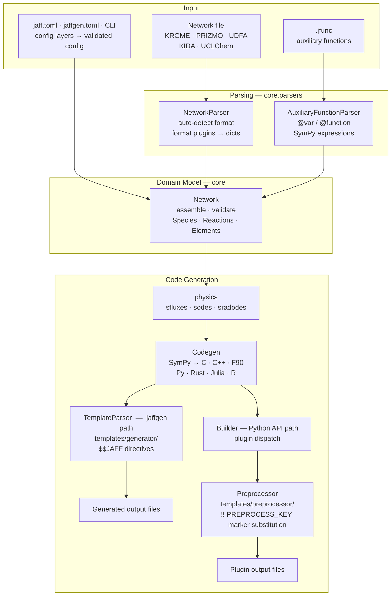

---
tags:
    - Development
icon: phosphor/stack
---

# Codebase Structure

This page maps the `src/jaff` source tree, explains what each package owns, and shows how data flows through the library from a raw network file to generated code.

## Package Map

```
src/jaff/
├── core/                       # Domain model
│   ├── chemistry.py            # Chemistry reference data as functions (element_table, cached)
│   ├── network/                # network.py (Network — main entry point; validation reports)
│   │   ├── _functions.py       # NetworkFunctions — the .jfunc functions (net.functions)
│   │   ├── _spec.py            # NetworkSpec — source-file paths (net.spec)
│   │   ├── _symbols.py         # NetworkSymbols — fixed physics symbols, densities (net.symbols)
│   │   └── config.py           # NetworkConfig ([network]), JaffTomlConfig, load_network_config
│   ├── reaction/               # reaction.py (Reaction) · reactions.py (Reactions)
│   │   ├── photo_reaction.py   # PhotoReaction — a photo reaction's component (rxn.photo)
│   │   ├── reaction_radiation.py # ReactionRadiation — every reaction's radiation component (rxn.rad)
│   │   ├── config.py           # [network.reactions] models (ReactionConfig, PhotoConfig, ...)
│   │   ├── _helper.py          # to_float_or_none
│   │   └── types/              # RateSegment / RateSegments (rate per temperature range)
│   ├── species/                # specie.py (Specie) · species.py (Species)
│   ├── elements/               # element.py (Element) · elements.py (Elements)
│   ├── parsers/                # File parsers (network + auxiliary)
│   │   ├── network/            # Multi-format network file parser
│   │   │   ├── _engine.py      # NetworkParser — drives format plugins
│   │   │   ├── _typing/        # parsedListProps, krome/prizmoFormatProps
│   │   │   └── _formats/       # One subpackage per format
│   │   │       ├── _parser.py  # Parser ABC (the only ABC) + register / all_parsers
│   │   │       ├── _record.py  # Record / ParsedRecord / ParseResult
│   │   │       ├── __init__.py # re-exports Parser, register, all_parsers, ...
│   │   │       ├── krome/      # parser.py + header.py · var.py · reaction.py handlers
│   │   │       ├── prizmo/     # parser.py + vars.py · reaction.py handlers
│   │   │       ├── udfa/       # parser.py + reaction.py handler
│   │   │       ├── uclchem/    # parser.py + reaction.py handler
│   │   │       └── kida/       # parser.py + reaction.py handler
│   │   └── auxiliary_func/     # .jfunc auxiliary function parser
│   │       ├── _engine.py      # AuxiliaryFunctionParser
│   │       └── function_props.py # AuxiliaryFunctionProps (one parsed function)
│   └── _typing/                # Shared core TypedDicts (ElementProps)
│
├── physics/                    # Symbolic ODE/flux generation + physics helpers
│   ├── photo_reactions/        # Photochemistry: cross sections, radiation, shielding
│   │   ├── _photo_band.py      # PhotoBand — a photo reaction's data for one band
│   │   ├── _photochemistry.py  # XsecProps, Photochemistry — cross-section lookups
│   │   ├── _radiation.py       # Radiation / RadiationGroup — radiation moment equations
│   │   ├── background_field.py # BackgroundField — tabulated reference radiation fields
│   │   ├── config.py           # RadiationConfig ([network.radiation])
│   │   └── shielding/          # Shielding-function registry (@register, by config.photo.shielding.type)
│   │       ├── _base.py        # ShieldingFunction ABC (name, reaction, config_model, params)
│   │       ├── config.py       # ShieldingConfig, ShieldingParams (plugin settings base)
│   │       ├── global_/        # Global models, reaction=None (e.g. leiden.py)
│   │       └── H2__PHOTON__H_H/ # Local H2 self-shielding (db1996, hg2015) + shared _utils
│   ├── dust/                   # Dust physics ([network.dust])
│   │   ├── dust.py             # Dust — container of a network's dust physics
│   │   ├── tabular.py          # Tabular — Milky Way grain cross sections from dust.hdf5
│   │   ├── photoelectric_emission.py # PhotoelectricEmission — chi_pe band scaling
│   │   └── config.py           # DustConfig, PhotoelectricEmissionConfig
│   ├── thermodynamics/         # Thermodynamics ([network.thermodynamics])
│   │   ├── thermodynamics.py   # Thermodynamics — dE/dt, dT/dt, lazily built EOS
│   │   ├── internal_energy.py  # InternalEnergy, DEDt
│   │   ├── config.py           # ThermodynamicsConfig
│   │   └── eos/                # eos_factory.py (EosFactory) · config.py (EOS models by type)
│   └── constants.py            # Physical constants (astropy Quantities)
│
├── plotting/                   # Spec-driven matplotlib plotting
│   ├── api.py                  # plot / plot_rates / plot_xsecs builders
│   ├── spec.py                 # FigureSpec / AxesSpec / SeriesSpec (dict validation)
│   ├── themes.py               # Style + Palette registries, cycling
│   ├── render.py               # FigureSpec -> (fig, axes)
│   ├── _layout.py              # hand-made tight grid layout (gaps, margins, legends)
│   ├── _legend.py              # tags, axes legends, shared figure legend
│   ├── _marks.py               # hollow markers by arc length
│   ├── _ticks.py               # exponent-labelled log axes
│   ├── _units.py               # energy/xsec unit conversion + axis labels
│   └── adapters/               # reactions -> series (rates.py, xsecs.py, _common.py)
│
├── codegen/                    # Code generation
│   ├── codegen.py              # Codegen: SymPy → C/C++/Fortran/Python/Rust/Julia/R strings
│   ├── _languages.py           # Language + one subclass per target (tokens, SymPy printers)
│   ├── _typing/                # ExtrasDict, IndexedReturn (Codegen return types)
│   ├── preprocessor.py         # Preprocessor — PREPROCESS_<KEY> marker substitution (plugins)
│   ├── builder.py              # Builder — runs jaff.plugins.<name>.plugin main()
│   └── templating/             # The $$JAFF template engine (TemplateParser)
│       ├── __init__.py         # Package entry; jaff.codegen re-exports TemplateParser
│       ├── parser.py           # TemplateParser: renders one file; language from LANG or extension
│       ├── engine.py           # Single pass splitting a template into text and directive blocks
│       ├── syntax.py           # Parses one directive header (Lark) into a command + options
│       ├── grammar.lark        # Lark grammar of a directive header and its { } option block
│       ├── blocks.py           # TextBlock / CommandBlock types produced by the engine
│       ├── options.py          # Options of one block: REPLACE pairs, USE names, groups
│       ├── resolve.py          # USE layering, per-command group checks, REPLACE compilation
│       ├── render.py           # Validates then renders blocks; registers DEFINEs, echoes directives
│       ├── context.py          # RenderContext: network, Codegen, file, echo settings, DEFINEs
│       ├── placeholders.py     # $name$ / $name op N$ substitution and line splitting
│       ├── values.py           # Parsers for option-group values
│       ├── errors.py           # TemplateError, turned into a ParserError with line info
│       └── commands/           # One package per command: command.py + props.py tables
│           ├── __init__.py     # COMMANDS registry
│           ├── base.py         # Command base class and shared rendering helpers
│           ├── repeat/         # REPEAT: command.py, props.py (PROPERTIES, option
│           │                   #   settings), expand.py (vertical/horizontal expansion)
│           ├── reduce/         # REDUCE: command.py, props.py (PROPERTIES)
│           ├── sub/            # SUB: command.py, props.py (TOKENS)
│           ├── get/            # GET: command.py, props.py (PROPERTIES)
│           ├── has/            # HAS: command.py, props.py (KINDS)
│           ├── define/         # DEFINE: named option sets for USE
│           ├── lang/           # LANG: target language of the file
│           ├── comment/        # COMMENT: token used to echo directives
│           └── end/            # END: closes a directive body
│
├── io/                         # Serialization and logging
│   ├── _io.py                  # .jaff gzip-JSON writing (loading unsupported); data table export
│   └── _logger.py              # JaffLogger + progress bars
│
├── config/                     # Path constants + the config machinery
│   ├── _config.py              # SRC_DIR, DATA_DIR, XSECS/SHIELDING dirs, ...
│   ├── base.py                 # ConfigModel base, LowerStr, PathLike, docstring descriptions
│   ├── loader.py               # Layers: load_layer, deep_merge, load_config, dump_config
│   ├── json_schema.py          # Editor JSON Schemas (schemas/*.schema.json)
│   └── reference.py            # Generated configuration reference page
│
├── drivers/                    # Data format adapters
│   ├── csv.py                  # CSV I/O
│   ├── hdf5.py                 # HDF5 I/O
│   ├── sqlite.py               # SQLite I/O
│   ├── pooch.py                # Download + cache remote data files (xsecs, shielding, radiation, dust)
│   └── _install.py             # Install verified downloads (HDF5 decompressed, others copied)
│
├── cli/                        # Command-line entry points (Typer)
│   ├── _helper.py              # CLI_KEYS (option → config key), --set, funcfile_arg
│   ├── jaffgen/                # jaffgen — template-driven code generation
│   │   ├── _engine.py          # JaffGen pipeline + Typer `generate` command
│   │   ├── _structs.py         # ResolvedPath, DEFAULT_OUTPUT
│   │   ├── config.py           # JaffgenConfig ([jaffgen]), load_jaffgen_config
│   │   └── _config_table.py    # [[jaffgen.table]] config → HDF5/CSV output
│   └── jaffx/                  # jaffx — network inspection / export
│       └── _engine.py          # JaffX handlers + nested Typer commands
│
├── plugins/                    # Named solver plugins for Builder (each a plugin.py)
│   ├── python_solve_ivp/       # SciPy solve_ivp wrapper
│   ├── fortran_dlsodes/        # Fortran DLSODES solver
│   ├── kokkos_ode/             # C++ VODE solver (header-only-integrators)
│   └── microphysics/           # AMReX microphysics driver
│
├── templates/                  # Bundled templates
│   ├── generator/<name>/       # $$JAFF directive templates for jaffgen / TemplateParser
│   │                           #   (flash, fortran_dlsodes, kokkos_ode, microphysics,
│   │                           #   python_solve_ivp, rosenbrock_cpp)
│   └── preprocessor/<name>/    # PREPROCESS_<KEY> marker templates used by the plugins
│
├── types/                      # Base data structures
│   ├── _catalogue.py           # Catalogue[T] — O(1) list + dict lookup
│   ├── _vector.py              # Typed numeric container
│   ├── _indexed.py             # IndexedList / IndexedValue
│   └── _hdf5.py                # HDF5 type helpers
│
├── common/                     # Shared utilities
│   ├── _helper.py              # Mass table loading, Fortran literals, symbolic dependency
│   │                           #   resolution, .jaff detection, module/subpackage import
│   ├── _integrators.py         # Numerical integration of SymPy expressions / tabulated data
│   ├── _sympy_json.py          # Versioned SymPy ↔ JSON encoding
│   ├── _fastlog.py             # Fast log2 approximation and its inverse
│   └── _welcome.py             # MOTD / version banner
│
├── errors/                     # Public exceptions (re-exported by jaff.errors)
│   ├── _parser.py              # ParserError, SympyJsonError
│   ├── _language.py            # InvalidLanguageError
│   └── _shielding.py           # RegistrationError (shielding registry)
│
├── data/                       # Raw data assets
│   ├── .downloads/             # Compressed, hash-verified pooch downloads + registry.txt (not bundled)
│   ├── atom_mass.csv           # Element mass table (bundled)
│   ├── xsecs/                  # Photo cross-section data (downloaded, not bundled)
│   │   ├── leiden.hdf5         # Leiden PDR cross sections (one group per reaction)
│   │   ├── norad.hdf5          # NORAD/OP ground-state photoionisation
│   │   └── verner_1996.csv     # Verner (1996) analytic-fit parameters
│   ├── shielding/              # Line-shielding tables (downloaded, not bundled)
│   │   └── leiden.hdf5         # Leiden line shielding (one group per reaction)
│   ├── background_radiation/   # Reference radiation fields (downloaded, not bundled)
│   │   └── radiation.hdf5      # One group per field (read by BackgroundField)
│   └── dust/                   # Dust cross sections (downloaded, not bundled)
│       └── dust.hdf5           # Milky Way grain cross sections (read by dust.Tabular)
│
├── db/                         # Prebuilt SQLite database
│   └── jaff.db                 # Mass + photo cross-section (Leiden/NORAD + Verner) tables, built from data/
│
└── _utils/                     # Standalone maintenance scripts
    ├── api_docs.py                     # Generate the API reference pages + API nav
    ├── generate_mass_table.py          # Build mass tables in jaff.db from data/atom_mass.csv
    ├── download_nahar_xsecs.py         # Download NORAD/OP ground-state photoionisation .dat files
    ├── collapse_xsecs_hdf5.py          # Merge per-reaction files into leiden.h5 / op.h5 (see below)
    ├── collapse_background_radiation_hdf5.py # Merge radiation .dat files into one HDF5 (see below)
    ├── split_xsecs_photodecay.py       # Split leiden.hdf5 / norad.hdf5 groups into photodecay channels
    ├── generate_photo_xsecs_table.py   # Build photo_reaction_cross_sections table in jaff.db
    ├── generate_ion_xsecs_table.py     # Build verner_cross_sections table in jaff.db
    └── compress_hdf5.py                # Gzip local data files for the mirror + registry lines
```

Downloaded data files are cached, compressed and hash-checked, under
`src/jaff/data/.downloads/`. `drivers/pooch.py` then installs a copy at the path
shown above (via `drivers/_install.py`): HDF5 files are rewritten uncompressed and contiguous so they load
quickly (the Leiden cross sections take ≈365 MB), other files are copied. A file
you place at an install path yourself is never overwritten; JAFF logs a warning
instead. Set `JAFF_OFFLINE=1` to skip all downloads.

To publish regenerated data, edit or rebuild the (uncompressed) files under
`src/jaff/data/` locally, then write compressed copies plus their registry
lines with
`uv run --extra dev python -m jaff._utils.compress_hdf5 src/jaff/data/xsecs/leiden.hdf5 ... --outdir upload/ --registry upload/registry.txt`
and upload the contents of `upload/` to the mirror.

## Architecture Diagram



## Data Flow — End to End

The table below traces a single `jaffgen` invocation from command line to output
files (see `JaffGen` in `cli/jaffgen/_engine.py`). `jaffgen` renders templates with
`TemplateParser` only; the `Preprocessor` / `Builder` path is a separate Python API
used by the solver plugins.

| Step | Component                                    | What happens                                                                                       |
| ---- | -------------------------------------------- | -------------------------------------------------------------------------------------------------- |
| 1    | `cli/jaffgen/_engine.py`, `config/`          | Parse CLI args (Typer); `run_config` merges jaffgen.toml (or the template's) < CLI < `--set` and validates `[jaffgen]`; `JaffGen(config)` builds the network (which merges `[network]` over its jaff.toml) and collects the template files; `run()` writes the output |
| 2    | `core/parsers/network/_engine.py`            | Auto-detect format via registered plugins; turn each reaction line into a `ParsedRecord`            |
| 3    | `core/parsers/auxiliary_func/_engine.py`     | Parse `.jfunc` file (if present); resolve `@var`/`@function` blocks into SymPy expressions         |
| 4    | `core/network/network.py`                    | Build `Species`, `Reactions`, `Elements` catalogues; validate duplicates, sinks, isomers           |
| 5    | `cli/jaffgen/_config_table.py`, `Network`    | Write any `[[jaffgen.table]]` data tables and the network's shielding tables to the output directory |
| 6    | `codegen/templating/`                        | `TemplateParser` renders each template file, expanding its `$$JAFF` directives                     |
| 7    | `codegen/codegen.py`                         | Directives call `Codegen`, which takes the symbolic fluxes/ODEs (`sfluxes`, `sodes`, `sradodes`; built by `Reactions.rates` / `Reactions.odes` / `Radiation.odes`) from the network and prints them for the file's language |
| 8    | `cli/jaffgen/_engine.py`                     | Write each rendered file, then the merged config as `config.toml`, to the output directory          |

## Key Design Decisions

**One `Parser` subclass per format, plain handler objects.**
Each network format is a single `Parser` subclass (the only ABC, in `_formats/_parser.py`) living in its own subpackage's `parser.py` under `core/parsers/network/_formats/`. A class registers itself with the `@register` decorator; `NetworkParser` discovers all parsers via `all_parsers()`, ordered by each parser's `priority` (not file or import order). A `Parser` owns a list of plain (no base class) **handlers** — one per line-type — each exposing a static `global_re`/`local_re` pair for detection/extraction and a `parse` (reaction) or `apply` (directive) method; the engine buckets raw `Record`s by owning parser and calls each parser's `process(records)`, which returns a `ParseResult` of `ParsedRecord`s + globals. Adding a new format means adding one subpackage — no edits to the engine or shared code. See [Adding a Parser](adding-parsers.md).

**SymPy as the intermediate representation.**
All rate expressions, fluxes, and ODEs live as SymPy objects inside `Network`. Code generation (`Codegen`) calls SymPy's language-specific printers (`ccode`, `cxxcode`, `fcode`, etc.), so adding a new target language is a single `Language` subclass in `jaff/codegen/_languages.py`.

**Plugin-based code generation.**
`Builder` discovers plugins at `jaff.plugins.<name>.plugin` and calls their `#!python main()`. Each plugin owns its template files and knows nothing about the parser. This keeps solver-specific logic out of the core library.

**`Catalogue[T]` for all domain collections.**
`Species`, `Reactions`, and `Elements` all inherit from `Catalogue`, giving O(1) lookup by integer index, slice, string name, _and_ serialized canonical name. The serialized form (e.g. `"+/H/H/O"` for H₂O⁺) enables duplicate detection that is independent of input name formatting.

**`.jaff` format.**
Networks can be saved as gzip-compressed JSON (`.jaff` files) via `io/_io.py`, with SymPy expressions in the versioned compact encoding of `common/_sympy_json.py`. Loading `.jaff` files is not supported at the moment.

## Utility Scripts

`src/jaff/_utils/` holds standalone, easy-to-run scripts for maintaining the bundled data. They are **not** part of the runtime data flow — they are run by hand (or during maintenance) to regenerate the assets in `data/` and `db/jaff.db`.

The cross-section scripts are ordered as a pipeline: download raw NORAD data,
collapse the per-reaction files into combined HDF5 files, then build the
SQLite lookup tables that JAFF queries at runtime.

| Script                                    | Purpose                                                                                                                                                                |
| ----------------------------------------- | ---------------------------------------------------------------------------------------------------------------------------------------------------------------------- |
| `api_docs.py`                             | Generate the API reference pages (`docs/reference/`) and the API nav section of `zensical.toml` from the docstrings.                                                  |
| `generate_mass_table.py`                  | Read `data/atom_mass.csv` and (re)build the element mass tables inside `db/jaff.db`.                                                                                   |
| `download_nahar_xsecs.py`                 | Download NORAD/OP (Nahar, OSU) ground-state photoionisation cross sections (Z = 1..26) into `data/xsecs/op/` using serialized reaction names.                          |
| `collapse_xsecs_hdf5.py`                  | Merge the per-reaction Leiden (`data/xsecs/leiden/*.h5`) and NORAD/OP (`data/xsecs/op/*.dat`) files into `data/xsecs/leiden.h5` and `data/xsecs/op.h5` (one group per reaction, photon energy in eV, σ in cm²). |
| `collapse_background_radiation_hdf5.py`   | Merge the radiation-field files `data/background_radiation/*.dat` into `data/background_radiation.hdf5` (one group per file).                                         |
| `split_xsecs_photodecay.py`               | Split the groups of `data/xsecs/leiden.hdf5` / `norad.hdf5` into one `photodecay` dataset per decay channel.                                                          |
| `generate_photo_xsecs_table.py`           | Build the `photo_reaction_cross_sections` table in `db/jaff.db` from `data/xsecs/leiden.hdf5` and `norad.hdf5` (`photo_absorption` flag, `decay_type` + `file.hdf5::<group>` pointers). |
| `generate_ion_xsecs_table.py`             | Build the `verner_cross_sections` table in `db/jaff.db` from the Verner (1996) analytic-fit parameters in `data/xsecs/verner_1996.csv`.                                |
| `compress_hdf5.py`                        | Write gzip-compressed copies of local data files (HDF5 datasets ≥ `--min-size`; others byte-copied) under `--outdir` and print/merge their `registry.txt` lines for the mirror. |

The collapse scripts' output names do not match the files the rest of JAFF reads:
`collapse_xsecs_hdf5.py` writes `leiden.h5` and `op.h5`, while
`split_xsecs_photodecay.py`, `generate_photo_xsecs_table.py` and the downloader read
or install `data/xsecs/leiden.hdf5` and `data/xsecs/norad.hdf5`; likewise
`collapse_background_radiation_hdf5.py` writes `data/background_radiation.hdf5`, while
`BackgroundField` and the downloader use `data/background_radiation/radiation.hdf5`.
Rename or move the outputs before feeding them to the later steps. No script in
`_utils/` builds `data/shielding/leiden.hdf5` or `data/dust/dust.hdf5`; they are
only downloaded.

Run a script as a module from the project root, e.g.:

=== "uv"

    ```bash
    uv run --extra dev python -m jaff._utils.generate_mass_table
    ```

=== "python"

    ```bash
    python -m jaff._utils.generate_mass_table
    ```
